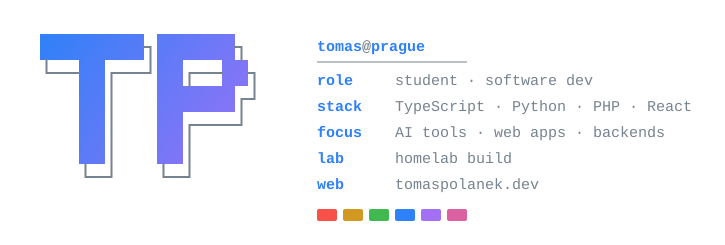

  

  
  
  

---

### 🚀 Featured projects

| Project | What it does | Built with |
|---|---|---|
| 📄 [**ask-your-pdfs**](https://github.com/Tomas-Polanek/ask-your-pdfs) | RAG app that answers questions over a folder of PDFs with exact page citations `[file, p. N]` and refuses to answer when the documents don't contain it | Python, Chroma, sentence-transformers, Gemini, Streamlit |
| 🥬 [**The Fridge Notebook**](https://github.com/Tomas-Polanek/The-Fridge-Notebook) | Tell it what's in your fridge, get three recipes with missing ingredients marked and a merged shopping list. CLI + web UI | Python, FastAPI, Pydantic, Gemini, Docker |
| 🗺️ [**Jičín parcel map**](https://github.com/Tomas-Polanek/Jicin-parcel-map) | Interactive map of 17 723 cadastral parcels around Jičín, built from ČÚZK INSPIRE open data | PHP 8, SQLite, JavaScript |
| 😴 [**SleepTrack**](https://github.com/Tomas-Polanek/SleepTrack) | Sleep tracking app with a calendar view and statistics | React, Vite, Tailwind, Node.js, Express |
| 🌐 [**portfolio**](https://github.com/Tomas-Polanek/portfolio) | My personal site: CZ/EN, bento layout, 3D model of my homelab build, project cards fed by the GitHub API | Next.js 16, React 19, TypeScript, Tailwind v4 |

### 🛠️ Tech I use

  
   
  
   
  

### 🌱 Right now

- 🎓 Studying software development
- 🤖 Building AI tools: retrieval, structured LLM output, grounded answers
- 🖥️ Tinkering with my homelab
- 🎮 Learning Python game dev with [pygame](https://github.com/Tomas-Polanek/Jumping-game-in-python)

---

<i>Feel free to reach out, always happy to talk about code.</i>

